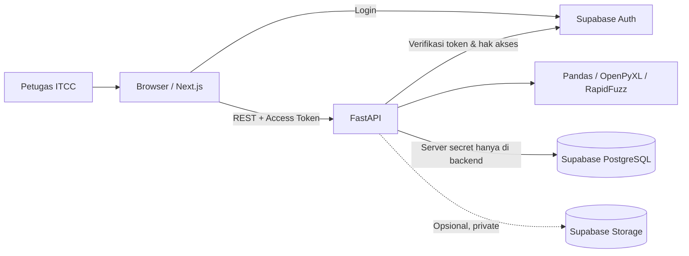
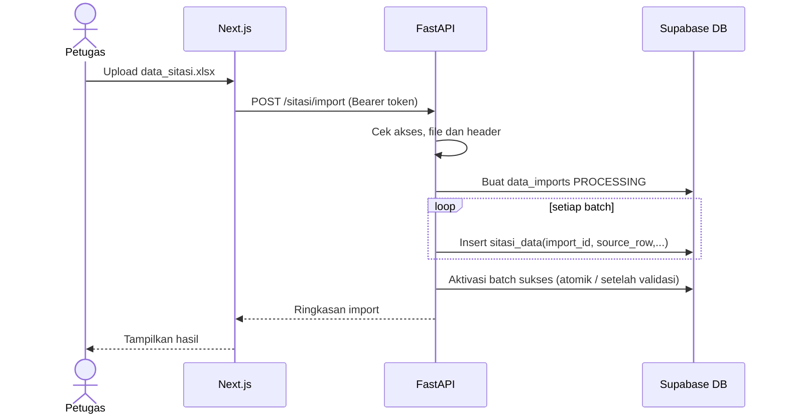
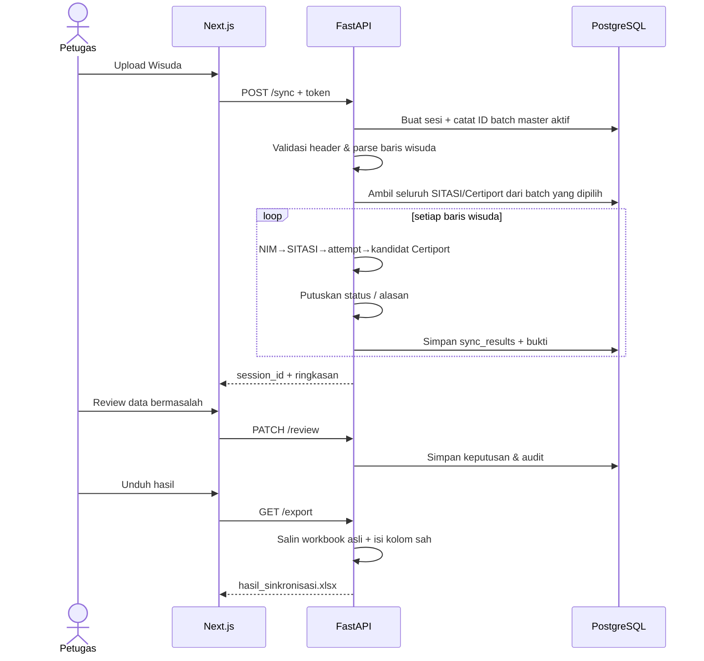
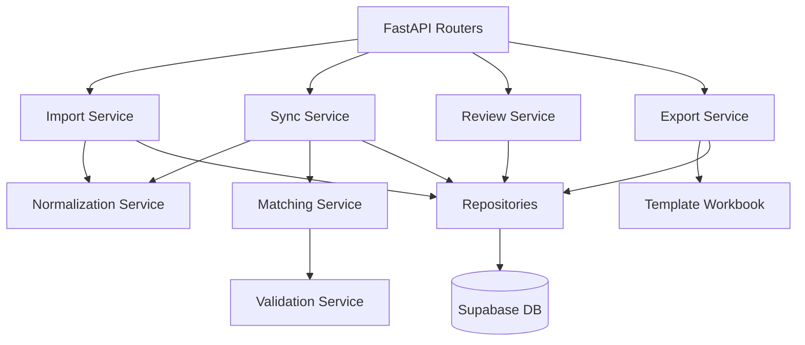

# 04 — Dokumen Arsitektur Sistem

## 1. Gambaran umum
Sistem memakai arsitektur **web client–backend API–database**. Tampilan dikerjakan di Next.js, sedangkan pengolahan Excel dan logika bisnis berada di FastAPI Python. PostgreSQL menyimpan hasil import/master/sesi, Supabase Auth mengelola akun petugas, dan private Storage disiapkan bila perlu menyimpan file asli serta hasil.

## 2. Alasan pemilihan teknologi
| Teknologi | Digunakan untuk | Alasan untuk tingkat mahasiswa |
|---|---|---|
| Next.js + TypeScript | Halaman, form, tabel, upload, status | UI terstruktur dengan komponen |
| Tailwind CSS | Styling sederhana | Pengembangan UI lebih cepat |
| Python + FastAPI | Endpoint REST, validasi, orkestrasi | Sintaks mudah diikuti dan dokumentasi API otomatis |
| Pandas | Baca/normalisasi tabel Excel | Sesuai pemrosesan data tabular |
| OpenPyXL | Menyalin dan mengisi workbook keluaran | Menjaga format, sheet, urutan lebih baik daripada membuat baru dari nol |
| RapidFuzz | Ranking nama kandidat | Alternatif deterministik untuk typo/abreviasi |
| Supabase PostgreSQL | Master, versi import, sesi, hasil review | Penyimpanan relasional |
| Supabase Auth | Login petugas | Tidak membuat sistem password sendiri |

Tidak menggunakan queue/microservices/LLM pada MVP kecuali data pengujian menunjukkan kebutuhan nyata.

## 3. Pemisahan tanggung jawab
### Next.js
- Antarmuka login, upload, master data, sinkronisasi, detail, review, export dan riwayat.
- Menyertakan token user ke backend; tidak menyimpan service secret.
- Tidak mengeksekusi aturan pencocokan final di client.

### FastAPI
- Memastikan user terautentikasi **dan** terotorisasi, memeriksa file, menyimpan import, memilih master aktif.
- Membentuk index lookup NIM dan nama serta menjalankan matching.
- Menyimpan bukti sumber setiap hasil dan keputusan reviewer.
- Menghasilkan file Excel dan mengembalikan download dengan content type benar.

### Database
- Menyimpan master dalam batch (`import_id`) bukan menghapus semua row saat import berikutnya.
- Menyimpan sesi dan hasil per baris wisuda yang diproses.
- Menyimpan sumber dan riwayat review; detail schema di `07_DATABASE_DESIGN.md`.

## 4. Arus data impor

### Catatan implementasi Phase 4
Starter sudah mempunyai penyisipan data per batch dan flag `is_active`, tetapi **pergantian aktif antarbatch dilakukan dengan dua operasi terpisah**; untuk ketahanan terhadap gagal di tengah/unggahan paralel, perlu disatukan dalam transaksi database atau RPC terkendali di backend. Endpoint juga **belum dilindungi login**. Jangan menjadikan starter langsung sebagai deployment publik.

## 5. Arus data sinkronisasi (rencana Phase 5–6)

## 6. Pemrosesan data yang efisien namun sederhana
- Hindari satu query database per mahasiswa; muat batch data sumber dengan pagination server-side atau chunk agar tidak terkena limit row API.
- Bangun dictionary indeks `NIM → daftar record` dan `nama_normalized + kategori → daftar record` di memori backend untuk satu sesi.
- Proses sinkronisasi ratusan mahasiswa secara sinkron dahulu, ukur waktu aktual. Tambah background job hanya jika benar-benar diperlukan; jika perlu progress real-time, rancang status sesi dan mekanisme polling.
- Jangan meminta seluruh baris SITASI/Certiport ke browser untuk melakukan join.

## 7. Boundary dan error handling
- Browser ↔ FastAPI: HTTPS pada deployment, CORS hanya origin resmi, batas file, access token.
- FastAPI ↔ Supabase: server secret/credential di environment server dan izin terkendali.
- Upload Excel: validasi ekstensi, isi file sebagai workbook, sheet/header, file rusak, ukuran, row kosong.
- Kegagalan saat proses: sesi `FAILED` + pesan ringkas; master aktif tetap utuh.
- Hasil tidak pasti: `PERLU_VERIFIKASI`, bukan diubah diam-diam menjadi `VALID`.

## 8. Diagram modul

## 9. Prinsip deployment
MVP dapat dijalankan lokal dalam dua proses Next.js dan FastAPI. Di masa penerapan, gunakan host frontend dan backend dengan HTTPS, database privat, environment secrets yang tidak masuk Git, dan akun petugas yang ditentukan. Backup/retensi data harus disetujui institusi.

## 10. Rujukan teknis resmi
- FastAPI file upload: https://fastapi.tiangolo.com/tutorial/request-files/
- Supabase RLS: https://supabase.com/docs/guides/database/postgres/row-level-security
- Supabase Auth: https://supabase.com/docs/guides/auth
- Next.js App Router: https://nextjs.org/docs/app

Rujukan menjelaskan cara kerja teknologi; spesifikasi bisnis kampus hanya dapat ditetapkan oleh pihak yang berwenang.
