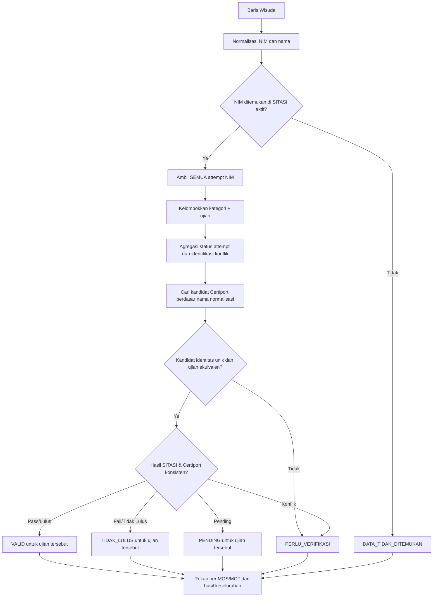

# 06 — Aturan Bisnis: Matching, Sertifikasi dan Validasi

Dokumen ini adalah **single source of truth** untuk logika pencocokan. Bersifat rancangan awal; aturan ujian dan ekspor memerlukan persetujuan pembimbing/petugas ITCC.

## 1. Prinsip utama
- **Identitas Wisuda↔SITASI:** cocokkan NIM terlebih dahulu (exact setelah normalisasi).
- **Identitas SITASI↔Certiport:** karena Certiport tanpa NIM, buat *kandidat* berdasarkan nama asli/normalisasi dan keunikan.
- **Kesesuaian ujian:** cocokkan kategori **dan** subprogram/sertifikasi (nama/versi ujian) menggunakan daftar alias yang dapat diaudit.
- **Kesimpulan:** ambigu/konflik tidak otomatis `VALID`. Fuzzy hanya memberi usulan.
- **Riwayat:** banyak attempt pada ujian yang sama adalah wajar; tidak memilih baris pertama saja.

## 2. Tahapan algoritma


## 3. Penilaian kesesuaian nama
1. `EXACT_NORMALIZED`: nama sama setelah pembersihan sederhana.
2. `ALTERNATIVE_SITASI`: nama Certiport cocok dengan nama SITASI walaupun nama Wisuda lebih panjang/singkat; perbedaan Wisuda↔SITASI tetap dicatat.
3. `FUZZY_CANDIDATE`: RapidFuzz memberi daftar kandidat **maksimal beberapa orang**, hanya untuk petugas.
4. `NO_CANDIDATE` atau `MULTIPLE_CANDIDATES`: tidak ada atau lebih dari satu kandidat yang masuk akal.
5. `MIN_TWO_WORDS`: kandidat Certiport hanya dianggap plausibel bila nama lengkap berbagi **minimal 2 kata** dengan nama target (contoh: `DAVID GABRIEL SEMBIRING` ⟷ `DAVID SEMBIRING`, `DAVID GABRIEL`, `GABRIEL SEMBIRING`, `GABRIEL DAVID`). Kandidat dengan kurang dari 2 kata cocok **bukan kandidat** dan mengarah ke `DATA_TIDAK_DITEMUKAN`. Nama target yang hanya satu kata memakai batas 1 kata agar nama tunggal yang sah tetap dapat dicocokkan.
6. `DECORATION_FOLD`: tanda baca dan kurung diabaikan saat normalisasi, sehingga `( DAVID.)`, `DAVID.`, dan `david` setara dengan `DAVID`. Nilai `nama_normalized`/`full_name_normalized` yang tersimpan dinormalkan ulang (idempoten) agar data lama yang masih berhias tanda baca tetap cocok untuk nama satu kata.

**Kebijakan default:** Jangan membuat threshold fuzzy sebagai ketetapan bisnis. Threshold (contoh usulan `>=90`, bukan fakta kelayakan) dipakai untuk menampilkan kandidat, dan dievaluasi pada test. Tidak boleh digunakan sendirian untuk menetapkan `VALID`. Kandidat yang lolos `MIN_TWO_WORDS` tetap berstatus `PERLU_VERIFIKASI` (bukan `VALID`) sampai ada bukti kuat (nama tepat & unik atau NIM+nama SITASI).

## 4. Kategori & kesetaraan ujian
Mapping kategori kandidat:
- SITASI `MOS` ↔ Certiport `Microsoft Office Specialist`.
- SITASI `MCF` ↔ Certiport `Microsoft Certified Fundamentals`.

Mapping subprogram contoh yang **belum otomatis disahkan**:
- SITASI `Word` ↔ Certiport `Word 2019`, `Microsoft Word 2019`.
- SITASI `Excel` ↔ Certiport `Excel 2019`, `Microsoft Excel 2019`.
- SITASI `Azure AI-900` ↔ Certiport `Microsoft Azure AI Fundamentals`.

Simpan alias pada konfigurasi/tabel referensi setelah dikonfirmasi. Jika hanya kategori yang sama tetapi ujian berbeda, perlakukan sebagai `PERLU_VERIFIKASI` untuk klaim ujian tersebut, bukan lintas-validasi otomatis.

## 5. Agregasi multiple attempt
Untuk satu kombinasi `(NIM, kategori, ujian ekuivalen)`:
1. Jika ada attempt `LULUS`, **riwayat tersebut menunjukkan pernah lulus ujian**, tanpa menghapus fail sebelumnya.
2. Jika tidak ada lulus dan status terbaru tidak jelas, tampilkan `PENDING`/`PERLU_VERIFIKASI` menurut bukti dan tanggal jika tersedia; data contoh SITASI tidak memiliki kolom tanggal ujian, jadi **tidak boleh menebak attempt terbaru dari urutan sheet**.
3. Jika tidak ada lulus dan semua attempt selesai dengan `TIDAK LULUS`/`GAGAL`, simpulkan belum ada bukti lulus SITASI untuk ujian itu.
4. Bila ada status yang tidak dikenali/kosong, catat `UNKNOWN` internal dan review jika berdampak pada hasil.

**Penting:** Aturan prioritas sederhana `LULUS > PENDING > TIDAK LULUS > GAGAL` bukan kronologi sertifikasi dan **tidak selalu mewakili status ujian terakhir**. Gunakan sebagai ringkasan keberadaan bukti, bukan klaim urutan waktu.

## 6. Matriks validasi per ujian
| Bukti SITASI | Certiport (identitas+ujian sesuai dan unik) | Hasil per ujian | Catatan |
|---|---|---|---|
| Ada `LULUS` | Ada `PASS` | `VALID` | Catat record bukti |
| Ada `LULUS` | Tidak ada kandidat unik | `PERLU_VERIFIKASI` | Bukti eksternal belum pasti |
| Tidak ada `LULUS`, ada fail | Ada `FAIL`, tanpa PASS | `TIDAK_LULUS` | Sesuai data yang tersedia, bukan keputusan akademik final |
| Tidak ada `LULUS` | Ada `PASS` | `PERLU_VERIFIKASI` | Konflik sumber |
| Ada `PENDING`, belum ada lulus | Tidak ada PASS | `PENDING` | Belum cukup bukti selesai |
| Salah satu | Kandidat nama ganda | `PERLU_VERIFIKASI` | Risiko salah orang |
| Salah satu | Ujian berbeda | `PERLU_VERIFIKASI` | Kategori sama tidak cukup |
| Tidak ada NIM SITASI | Apapun | `DATA_TIDAK_DITEMUKAN` | Jangan lewati SITASI secara otomatis |
| Tidak ada hasil cukup | `INCO`/kosong | `PERLU_VERIFIKASI` | Hasil Certiport belum cukup |

## 7. Status per program dan keseluruhan
Simpan hasil per ujian (mis. MOS Word, MOS Excel, MCF AI-900), kemudian sediakan ringkasan `mos_status`, `mcf_status`, dan `validation_status` keseluruhan untuk tampilan. **Jangan menyamakan keseluruhan VALID dengan semua sertifikasi telah lengkap**, karena kewajiban program bagi tiap mahasiswa belum disahkan.

Usulan prioritas status keseluruhan untuk memandu UI, **harus dikonfirmasi**:
- Jika tidak ada NIM SITASI → `DATA_TIDAK_DITEMUKAN`.
- Jika ada konflik/review belum terselesaikan pada kolom yang akan diisi → `PERLU_VERIFIKASI`.
- Jika hanya ditemukan pending yang relevan → `PENDING`.
- Jika tidak ada bukti lulus untuk sertifikasi yang dituju dan semua selesai gagal → `TIDAK_LULUS`.
- `VALID` hanya untuk **klaim sertifikasi yang bukti pendukungnya lengkap**, bukan jaminan syarat wisuda terpenuhi.

## 8. Keputusan manual
Petugas dapat memilih `KONFIRMASI_COCOK`, `TIDAK_COCOK`, atau `TUNDA_VERIFIKASI`; keputusan disimpan terpisah dari bukti sumber. Butuh catatan alasan dan identitas petugas. Konfirmasi identitas **tidak boleh otomatis mengubah Result=FAIL menjadi PASS**. Jika ada koreksi data sumber, idealnya perbarui file sumber resmi dan jalankan ulang.

## 9. Pseudocode konseptual
```python
for baris in excel_wisuda:
    nim = normalize_nim(baris['NIM'])
    sumber_sitasi = sitasi_by_nim.get(nim, [])
    if not sumber_sitasi:
        simpan_hasil(baris, 'DATA_TIDAK_DITEMUKAN')
        continue

    ujian_sitasi = kelompokkan_berdasarkan_jenis_dan_ujian(sumber_sitasi)
    for ujian in ujian_sitasi:
        ringkasan_attempt = agregasi_riwayat(ujian)
        calon_certiport = cari_kandidat_nama_dan_ujian(ujian, certiport_index)
        hasil = validasi_bukti(ringkasan_attempt, calon_certiport)
        simpan_detail(hasil, bukti_sitasi=ujian, kandidat=calon_certiport)

    simpan_rekap_per_baris_wisuda()
```

Pseudocode di atas belum menangani I/O/permission/error, yang dijabarkan di SRS dan API.

## 10. Larangan implisit
Jangan mengisi `Sertifikasi MOS/MCF` jika kandidat hanya didasarkan fuzzy nama. Jangan mengambil skor `Score` sebagai bukti lulus ketika `Result=FAIL`. Jangan menyatukan MOS Excel dan MOS Word hanya karena program sama. Jangan membuang ketidakpastian karena ingin jumlah hasil `VALID` lebih besar.

## 11. Revisi aturan pencocokan (2026-10-13)
Revisi ini **menggantikan** ketentuan "VALID butuh SITASI LULUS + Certiport PASS" (ADR-002) dengan ketentuan berikut:
1. **Cocok SITASI** = NIM **dan** nama sama (nama dinormalisasi). Bila cocok, status LULUS/TIDAK LULUS + skor dari SITASI **sudah cukup**; Certiport hanya bukti silang. Bila Certiport mencatat `FAIL` pada ujian yang sama → `PERLU_VERIFIKASI`.
2. **Bila tidak cocok di SITASI** → cek Certiport berdasarkan nama. Nama tepat & unik → status dari Certiport (`PASS`→VALID, `FAIL`→TIDAK_LULUS). Nama hanya mirip atau ganda → `PERLU_VERIFIKASI` disertai daftar nama mirip (suku kata/typo).
3. Tidak ada di SITASI **dan** Certiport → `DATA_TIDAK_DITEMUKAN`. NIM ada di SITASI tetapi nama berbeda dan tidak ada bukti lain → `PERLU_VERIFIKASI` (bukan "tidak ditemukan").
4. **Kolom MCF** hanya relevan untuk prodi kode `31` (S1 Teknik Informatika) & `32` (S1 Sistem Informasi); di luar itu MCF **tidak dihitung** dan tidak memengaruhi status keseluruhan.

## 12. Aturan ringkas 2026-10-23 (menggantikan aturan yang bertentangan)
Sumber data kini hanya memuat kolom berguna: SITASI `NIM, Nama, Kode NIM, Program Studi, Sertifikasi, Nilai, Status`; Certiport `Nama, Sertifikasi, Nilai, Status`. Tidak ada lagi kolom sub-program/ujian rinci.

1. **Identitas SITASI:** NIM exact (string) adalah kunci utama. Nama tetap dibandingkan dan dicatat sebagai peringatan, tetapi tidak membatalkan hasil bila NIM sama.
2. **Identitas Certiport:** hanya **exact normalized name**. Kandidat fuzzy/mirip tidak pernah mengisi otomatis.
3. **Kategori ujian:** karena tidak ada sub-program, kecocokan ujian ditentukan oleh kategori `MOS`/`MCF` yang sama. `MTCNA` disimpan tetapi tidak mengisi kolom Wisuda.
4. **Hanya LULUS yang diisi:** kolom `Sertifikasi MOS`, `Sertifikasi MCF`, dan `Title Microsoft` hanya diisi bila status program `VALID` (ada bukti LULUS). Status lain menghasilkan sel **kosong**.
5. **MCF:** hanya diisi untuk prodi kode `31` dan `32`.
6. **Format isi:** `MOS (Lulus)` / `MCF (Lulus)`. `Title Microsoft`: `MOS`, `MCF`, atau `MOS, MCF`.
7. **Berkas keluaran:** dibuat sebagai berkas baru (mis. `hasil_wisuda_terisi.xlsx`) dengan layout `data_wisuda.xlsx` dipertahankan. Berkas asli tidak ditimpa.
8. **Prioritas exact name:** bila ada nama persis dan kandidat fuzzy lain, nama persis yang dipakai. Risiko dua orang dengan nama lengkap identik tetap dicatat sebagai keterbatasan sumber Certiport (tanpa NIM).

## 13. Pemisahan identitas dan validasi sertifikasi (2026-10-23)
Kasus regresi: `MUHAMMAD ALFARISY AKBAR` sempat menampilkan `MUHAMMAD AKBAR` sebagai pemilik skor MOS/MCF. Penyebabnya, record kandidat fuzzy dipakai sebagai bukti dan exam.

Aturan yang berlaku:
1. **Identitas SITASI:** exact NIM. Nama hanya pembanding dan peringatan.
2. **Identitas Certiport:** hanya **seluruh token nama sama** setelah normalisasi. Urutan kata dan gelar akademik boleh berbeda (`S.Kom`, `M.T`, `Ir`, `Dr`, dan sejenisnya diabaikan). Kecocokan sebagian **tidak pernah** dianggap identitas.
3. **Skor fuzzy:** memakai cakupan token, bukan hanya kemiripan string. `MUHAMMAD AKBAR` vs `MUHAMMAD ALFARISY AKBAR` menghasilkan skor 67 (`partial_name_candidate`), bukan 100.
4. **Kandidat fuzzy bukan bukti:** record kandidat tidak boleh masuk `sync_evidence`, tidak boleh menghasilkan exam `certiport_only`, dan tidak boleh memberi skor/status miliknya kepada mahasiswa.
5. **Status kandidat:** bila tidak ada identitas exact tetapi ada kandidat, hasil `PERLU_VERIFIKASI`; bila tidak ada kandidat sama sekali, `DATA_TIDAK_DITEMUKAN`.
6. **Konflik NIM:** bila record Certiport menyediakan NIM dan berbeda dari NIM wisuda, identitas dianggap bertentangan (`R16_NIM_CONFLICT`) dan tidak boleh dipakai untuk mengisi.
7. **Beberapa kandidat:** tidak ada pemilihan kandidat pertama. Semua kandidat ditampilkan dengan nama asli, nama normalisasi, skor, file, baris, status ujian, dan alasan.
8. **PASS bukan konfirmasi pemilik:** status `PASS` hanya berlaku setelah identitas exact terkonfirmasi. PASS pada kandidat parsial/fuzzy tidak mengisi kolom Wisuda.
