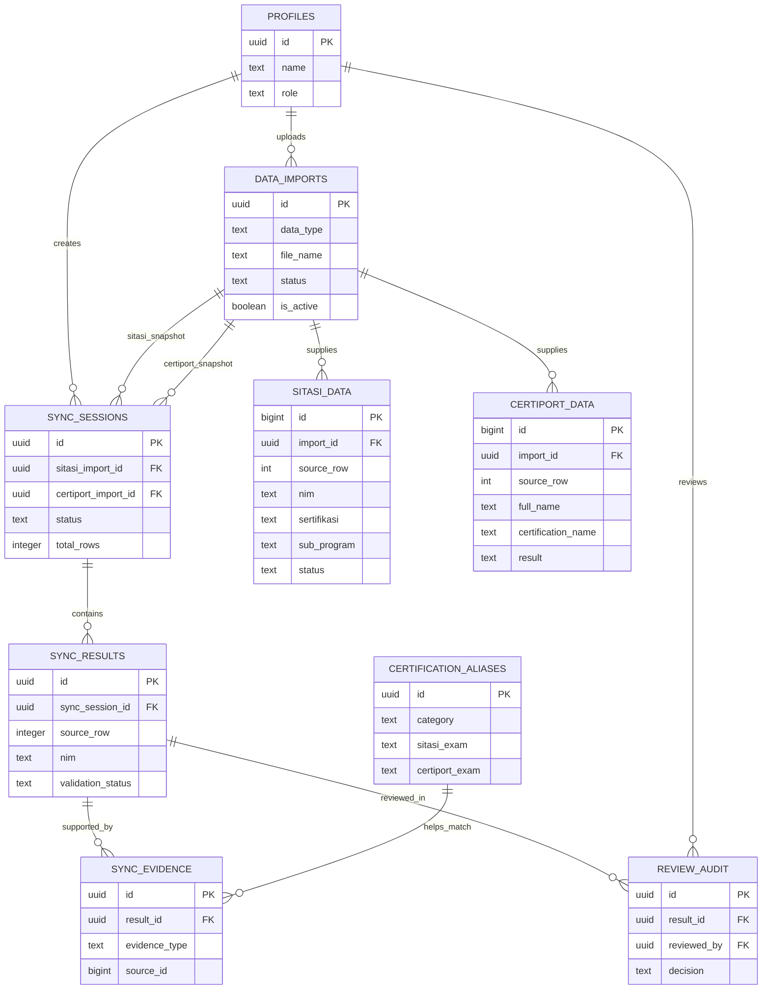

# 07 — Rancangan Database Supabase/PostgreSQL

## 1. Prinsip model data
Rancangan ini **mengembangkan Phase 4**, bukan menggantinya. Migration `database/migrations/20260930120000_phase4_foundation.sql` menyiapkan `profiles`, `data_imports`, `sitasi_data`, dan `certiport_data`. Tabel sesi, hasil, reviewer dan referensi ditambahkan pada tahap berikutnya. Jangan menganggap tabel yang direncanakan sudah dibuat di database.

## 2. ERD ringkas (target)


Catatan ERD: relasi `DATA_IMPORTS → SYNC_SESSIONS` terjadi dua kali sebagai rujukan versi SITASI dan Certiport. `SYNC_EVIDENCE.source_id` mereferensikan SITASI/Certiport berdasarkan `evidence_type`; secara fisik dapat diganti dua FK nullable agar referensial integrity lebih kuat.

## 3. Implementasi Phase 4: yang sudah ada di SQL
### `data_imports`
`id` UUID PK, `data_type` (`SITASI|CERTIPORT`), `file_name`, `sheet_name`, `total_rows`, `imported_rows`, `status` (`PROCESSING|COMPLETED|FAILED`), `is_active`, `error_message`, `created_by`, `created_at`, `completed_at`.

Index unik parsial memastikan maksimal satu batch aktif per jenis, bukan memastikan sudah ada batch aktif. Backend harus mengecek keduanya tersedia sebelum sinkronisasi.

### `sitasi_data`
`id` bigint PK, `import_id` FK, `source_row`, `nim`, `nama`, `nama_normalized`, `fakultas`, `kode_nim`, `program_studi`, `angkatan`, `sertifikasi`, `sub_program`, `nilai`, `status`, `created_at`. Constraint unik `(import_id, source_row)`.

### `certiport_data`
`id` bigint PK, `import_id` FK, `source_row`, `first_name`, `last_name`, `full_name`, `full_name_normalized`, `program_name`, `certification_name`, `score`, `result`, `created_at`. Constraint unik `(import_id, source_row)`.

**Tidak boleh** membuat `nim` unique pada SITASI karena riwayat attempt berulang.

## 4. Fondasi otorisasi dan usulan Phase 5–6
### `profiles` — tersedia pada migration Phase 4
`id` UUID FK `auth.users`, `display_name`, `role`, `is_active`, `created_at`, dan `updated_at`. Role dikelola server/DB dan tidak diambil dari user metadata yang dapat diedit user. RLS deny-by-default mencegah akses browser langsung.

### `sync_sessions` — target
| Field | Tipe | Tujuan |
|---|---|---|
| `id` | uuid PK | ID proses |
| `created_by` | uuid FK | Pemilik kegiatan |
| `file_name` | text | File wisuda |
| `original_file_path` | text nullable | Penyimpanan private |
| `output_file_path` | text nullable | File ekspor |
| `sitasi_import_id` | uuid FK | **Versi SITASI terpakai** |
| `certiport_import_id` | uuid FK | **Versi Certiport terpakai** |
| `total_rows` | integer | Jumlah baris proses |
| `total_valid`, `total_review`, `total_not_found` | integer | Ringkasan, dihitung dari hasil |
| `status` | text | `UPLOADED`, `PROCESSING`, `COMPLETED`, `FAILED` |
| `error_message` | text nullable | Kesalahan aman |
| `created_at`, `completed_at` | timestamptz | Audit |

### `sync_results` — target
`id` UUID PK, `sync_session_id` UUID FK, `source_row` int, `nim` text, `nama_wisuda` text, `nama_sitasi` text nullable, `name_match_type` text, `mos_status` text, `mcf_status` text, `mos_programs` JSONB, `mcf_programs` JSONB, `validation_status` text, `needs_review` boolean, `review_note` text nullable, `created_at`. Unique `(sync_session_id, source_row)` agar satu baris Wisuda memiliki satu rekap.

### `sync_evidence` — target (disarankan)
`id`, `result_id`, `category`, `exam`, `sitasi_row_id` nullable, `certiport_row_id` nullable, `match_method`, `match_score` nullable, `evidence_status`, `reason`. Simpan **per ujian** sehingga bukti banyak attempt tidak hilang dari desain hasil agregat.

### `review_audit` — target (disarankan)
`id`, `result_id`, `reviewed_by`, `decision`, `note`, `previous_status`, `new_status`, `created_at`. Audit bersifat append-only; jangan mengganti audit lama dengan update.

### `certification_aliases` — target opsional sebelum hasil final
`id`, `category`, `sitasi_exam`, `certiport_exam`, `is_approved`, `approved_by`, `updated_at`. Konfigurasi alias hanya diubah oleh pihak berwenang.

## 5. Integritas dan keandalan
- SQL Phase 4 saat ini memiliki indeks dasar dan RLS + revoke untuk `anon` dan `authenticated`; setiap tabel baru harus menerapkan pembatasan akses serupa dengan pola yang sesuai kebutuhan.
- Pergantian batch aktif **sebaiknya atomik**; lakukan dalam satu transaksi dengan pengecekan kandidat batch sudah `COMPLETED`.
- Catat ID batch aktif saat sesi dimulai; proses berikutnya tidak bergantung pada batch yang berubah di tengah proses.
- Jika menghapus batch lama, cek lebih dulu apakah direferensikan oleh `sync_sessions` dan aturan retensi sudah disetujui.

## 6. Contoh query konseptual
```sql
-- Riwayat SITASI untuk satu NIM pada satu versi import
select * from public.sitasi_data
where import_id = :sitasi_import_id and nim = :nim
order by source_row;
```
`source_row` dipakai untuk pelacakan, **bukan** tanggal atau urutan attempt.

## 7. Keamanan
Tabel data mahasiswa tidak boleh dapat dibaca bebas memakai publishable/anon key. RLS + grants + otorisasi FastAPI dipakai sesuai fungsi; jika menggunakan `service_role`, key hanya ada di backend yang dipercaya. Koneksi frontend harus tidak pernah memuat secret. Lihat `11_SECURITY_PRIVACY.md`.

## 8. Migrasi database
Jangan menjalankan skema tambahan langsung pada produksi tanpa backup dan review. Buat file migrasi baru yang terurut dari Phase 4, uji pada lingkungan development, verifikasi jumlah tabel/constraint/index, lalu catat hasil pengujian.
