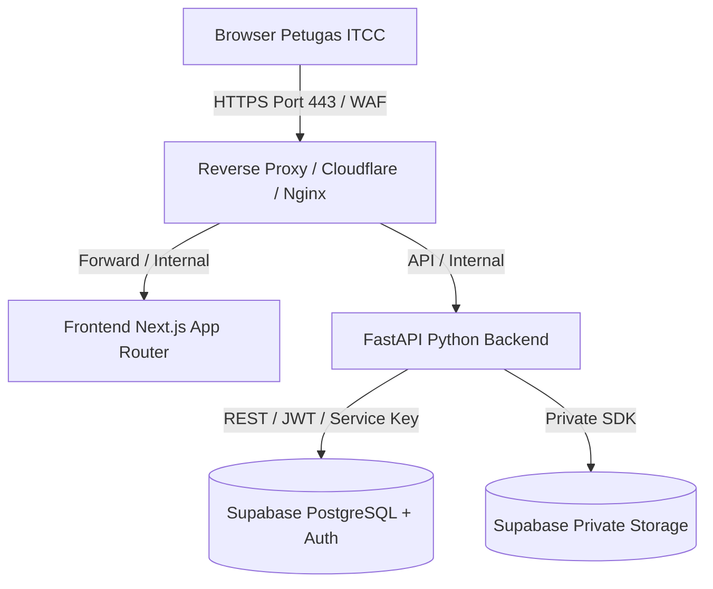

# 17 — Panduan Operasional & Runbook Deployment (Dev / Staging / Production)

Dokumen ini adalah **runbook operasional dan arsitektur deployment resmi** ITCC Wisuda Sync.

> **PERINGATAN KEAMANAN & ATURAN DEPLOYMENT:**
> 1. Sistem ini mengolah data identitas akademik mahasiswa dan hasil sertifikasi resmi. **Sistem TIDAK BOLEH dibuka untuk publik** tanpa otorisasi jaringan internal/kampus.
> 2. Deployment ke lingkungan Production **HANYA DAPAT DILAKUKAN** setelah:
>    - Ada instruksi tertulis dan izin resmi dari pemilik sistem/Kepala ITCC.
>    - Keputusan output mapping disahkan secara tertulis pada `docs/20_OUTPUT_MAPPING_APPROVAL.md`.
>    - Seluruh skenario UAT selesai dengan status **PASS**.
> 3. Jangan pernah menulis URL atau bukti live deployment fiktif. Selama lingkungan berizin belum disediakan, status deployment adalah **TERBLOKIR (DRAFT RUNBOOK READY)**.

---

## 1. Pemisahan Lingkungan (Dev / Staging / Production)

| Parameter | Development (Lokal) | Staging (Pre-Release) | Production (Live Operasional) |
|---|---|---|---|
| **Tujuan** | Pengembangan & automated test | Replikasi lingkungan penuh & UAT petugas | Operasional sinkronisasi wisuda sah |
| **Akses Jaringan** | `localhost` | VPN Kampus / IP Whitelist ITCC | Jaringan Internal Kampus / Private Subnet |
| **Dataset** | 100% Data Sintetis Anonim | Snapshot anonim / Fixture bertingkat | Data Riil Berizin (ITCC & Akademik) |
| **Supabase DB** | Local / Dev Project terpisah | Project Staging terisolasi | Project Production terenkripsi (AES-256) |
| **Public Signup** | Dinonaktifkan (Disabled) | Dinonaktifkan (Disabled) | Dinonaktifkan (Disabled) |
| **Storage Bucket** | Local file / Private mock | Supabase Private Bucket (`wisuda-staging`) | Supabase Private Bucket (`wisuda-prod`) |
| **Log Level** | `DEBUG` (tanpa PII) | `INFO` (audit ID only) | `WARNING` / `AUDIT` (hash identifier) |

---

## 2. Arsitektur Hosting, Domain, dan HTTPS



### A. Frontend (Next.js 15)
- **Host Rekomendasi:** Node.js container (Docker) pada server internal ITCC atau platform hosting privat (misal: Railway private service / VM Kampus).
- **Domain:** `https://wisudasync.itcc.kampus.ac.id` (internal TLS/HTTPS tersertifikasi Let's Encrypt / Wildcard Kampus).
- **Konfigurasi Lingkungan:**
  ```bash
  NEXT_PUBLIC_API_URL=https://api-wisudasync.itcc.kampus.ac.id/api/v1
  NEXT_PUBLIC_SUPABASE_URL=https://<prod-ref>.supabase.co
  NEXT_PUBLIC_SUPABASE_PUBLISHABLE_KEY=<public-anon-key>
  ```

### B. Backend (Python 3.12 + FastAPI)
- **Host Rekomendasi:** Container Linux (Gunicorn + Uvicorn workers) dengan alokasi memori minimal 2 GB dan CPU 2 core untuk pemrosesan file Excel ratusan baris.
- **Reverse Proxy:** Nginx mengelola SSL termination, buffering request upload (max 15MB), dan timeout 120s untuk parsing sinkron.
- **Konfigurasi Lingkungan:**
  ```bash
  APP_ENV=production
  FRONTEND_URL=https://wisudasync.itcc.kampus.ac.id
  SUPABASE_URL=https://<prod-ref>.supabase.co
  SUPABASE_SERVICE_ROLE_KEY=<secret-from-secret-manager>
  MAX_UPLOAD_BYTES=10485760
  RATE_LIMIT_PER_MINUTE=60
  ```

---

## 3. Tata Kelola Rahasia & Secret Manager

1. **Prinsip Nol Rahasia di Git:** Dilarang commit berkas `.env`, token, atau private key ke git. Gunakan `.gitignore`.
2. **Secret Storage Production:**
   - Gunakan Secret Manager (misal: Infisical, AWS Secrets Manager, GCP Secret Manager, atau Docker Secrets internal).
   - Injeksi credential hanya melalui environment variable runtime server saat container dijalankan.
3. **Pemisahan Kunci:**
   - Browser client hanya menerima `NEXT_PUBLIC_SUPABASE_PUBLISHABLE_KEY`.
   - `SUPABASE_SERVICE_ROLE_KEY` **hanya berada di backend server**.

---

## 4. Keamanan Jaringan, CORS, dan Autentikasi

1. **Pembatasan CORS:**
   - Backend membatasi `allow_origins` tepat ke domain frontend resmi (`https://wisudasync.itcc.kampus.ac.id`).
   - Wildcard (`*`) dilarang keras di staging dan production.
2. **Supabase RLS (Row Level Security):**
   - Seluruh tabel (`data_imports`, `sitasi_data`, `certiport_data`, `sync_sessions`, `sync_results`, `sync_evidence`, `review_audit`, `profiles`) menerapkan kebijakan **DENY ALL BY DEFAULT**.
   - Akses manipulasi data hanya diberikan ke `service_role` yang dipanggil eksklusif oleh FastAPI.
3. **Otorisasi Petugas:**
   - Setiap endpoint data memverifikasi bearer JWT Supabase dan memeriksa status aktif di tabel `profiles` via `require_staff`.
   - Public signups dimatikan; pembuatan akun staf hanya melalui invite dashboard admin.

---

## 5. Kebijakan Logging Tanpa Data Pribadi (PII Protection)

Sistem wajib mematuhi privasi data akademik:
- **Dilarang mencatat:** Nama mahasiswa lengkap, NIM mahasiswa mentah, nilai ujian individual, atau nomor kontak ke file log server / console.
- **Pencatatan yang diizinkan:** ID Sesi (`session_id`), ID Batch (`import_id`), jumlah baris terproses, waktu eksekusi (ms), dan kode HTTP status.
- **Format Audit:**
  ```text
  [INFO] 2026-10-09T17:00:00Z | session=uuid | action=SYNC_PROCESSED | total=424 | valid=380 | review=40 | duration_ms=1850 | actor=uuid-staff
  ```

---

## 6. Prosedur Backup, Restore, dan Rollback

### A. Strategi Backup Rutin
1. **Automated Daily Backup:** Database Supabase menjalankan Point-in-Time Recovery (PITR) harian dengan retensi minimal 30 hari.
2. **Pre-Migration Snapshot:** Sebelum menjalankan migrasi SQL apa pun di Staging/Production, jalankan full backup:
   ```bash
   pg_dump -h <db-host> -U postgres -d postgres -F c -b -v -f "backup_pre_migration_$(date +%Y%m%d_%H%M%S).dump"
   ```

### B. Prosedur Rollback Aman
1. **Rollback Aplikasi:**
   - Container image di-tag dengan commit hash spesifik (contoh: `wisudasync-backend:sha-abc1234`).
   - Jika terjadi regresi, deploy ulang image versi stabil sebelumnya (waktu pemulihan < 5 menit).
2. **Rollback Database:**
   - Gunakan skrip rollback teruji dari folder `database/rollbacks/` (contoh: `20260930120000_phase4_foundation_rollback.sql`).
   - Skrip rollback menolak eksekusi jika sudah ada data operasional tersimpan demi mencegah kehilangan data.

---

## 7. Pemantauan Kesehatan (Health Monitoring) & Alerting

1. **Endpoint Liveness & Readiness:**
   - `GET /api/v1/health` mengembalikan HTTP 200 `{ "status": "ok", "app_env": "production" }` tanpa membuka rahasia sistem.
2. **Monitoring Uptime:**
   - Monitoring internal (Uptime Kuma / Prometheus) melakukan polling `GET /health` setiap 60 detik.
3. **Threshold Peringatan (Alert Triggers):**
   - Respon API $> 5000\text{ ms}$ pada pemrosesan sinkronisasi.
   - Peningkatan error 5xx $> 1\%$ dalam kurun 5 menit.
   - Memory server $> 85\%$ selama lebih dari 3 menit.

---

## 8. Protokol Eksekusi Dry-Run Staging Sebelum Production

Sebelum kode diterapkan ke Production, lakukan protokol 5 langkah di Staging:
1. **Langkah 1 (DB Migration Dry-Run):** Terapkan skrip migrasi SQL pada database staging; jalankan skrip verifikasi `database/checks/phase4_foundation_check.sql`.
2. **Langkah 2 (Master Data Batch Test):** Unggah workbook master SITASI dan Certiport sintetis, verifikasi aktivasi batch atomik.
3. **Langkah 3 (Sync & Review Test):** Unggah daftar wisuda sintetis, pastikan hasil matching, reason codes, dan review trail tersimpan akurat.
4. **Langkah 4 (Export Gate Proof):** Pastikan ekspor draft menghasilkan watermark `[DRAFT]` dan ekspor final mengembalikan `403 Forbidden` selama belum disahkan.
5. **Langkah 5 (Sign-off Pemilik):** Presentasikan hasil kepada Kepala ITCC untuk memperoleh persetujuan tertulis implementasi production.
